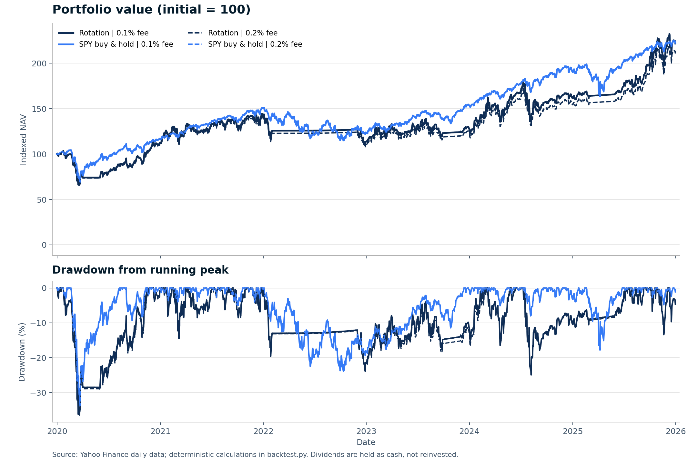

# SOXX / SPY / BIL 月度轮动策略回测

> 回测区间：2020-01-02 开盘至 2025-12-31 收盘｜初始资金：100,000 美元｜研究生成日：2026-10-29  
> 本报告为历史规则回测，不构成投资建议或收益预测。

## 一、主要结论

1. 基础费率下，轮动策略期末为 $221,714.88，略低于 SPY 买入持有的 $222,509.14，差额为 $794.26；同时年化波动更高（26.92% 对 20.24%），最大回撤更深（-36.40% 对 -33.69%）。
2. 单边费率由 0.1% 升至 0.2% 后，轮动策略期末净值减少 $11,008.04，累计收益从 121.71% 降至 110.71%，CAGR 从 14.20% 降至 13.24%。高费率下落后 SPY 基准 $11,580.23。
3. 共 72 个可执行月度信号（含 2019 年末初始信号），46 次持仓不变不交易，实际换仓 25 次、交易腿 51 条。基础费率累计费用 $6,554.28，费率和换手是该策略的重要拖累。
4. 持仓交易日占比为 SOXX 56.10%、SPY 20.23%、BIL 23.67%。分年度看并非持续落后，例如 2025 年轮动策略表现强于 SPY，但六年综合结果未形成风险调整后的优势。
5. 本结果只支持对该固定规则在 2020—2025 年历史样本的事后评价，不支持推断未来收益；未进行参数寻优或样本外验证。

## 二、策略规则与计算口径

1. 股票池固定为 SOXX、SPY、BIL，只做多、允许碎股，初始资金 100,000 美元。回测交易日为 2020-01-02 至 2025-12-31，共 1,508 个共同交易日。
2. 每月最后一个共同交易日收盘后，分别计算 SOXX 与 SPY 的 60 交易日总回报：Adj Close(t) / Adj Close(t−60) − 1。选择回报较高且为正者；相等且为正选 SPY；两者均非正或最高回报非正时选 BIL。
3. 信号后的下一个交易日开盘执行。持仓不变不交易。2019-12-31 信号用于 2020-01-02 开盘建仓，其 60 日窗口从 2019-10-04 开始；初始信号选择 SOXX（SOXX 18.03%，SPY 9.88%）。2025-12-31 信号因执行日落在样本外，不产生样本内交易。
4. 信号使用 Yahoo Adj Close（拆股与现金分红调整的总回报代理）。交易与估值使用同一数据源仅拆股调整的 Open / Close，不把分红复权价当成成交价。SOXX 2024-03-07 的 3:1 拆股已在价格、每股分红和份额单位中一致反映，不再次调整持仓份额。
5. 分红在除息日按开盘交易前的既有持仓计入现金，不自动再投资、现金不计息；下一次实际换仓时现金一并投入。若一直持有，分红现金留存到期末。基准采用同样的现金分红处理。
6. 换仓卖出和买入分别按成交额收取单边 0.1%；翻倍情景为单边 0.2%。买入份额 = 可用现金 / [开盘价 × (1 + 费率)]。不计价差、滑点、税费和冲击成本。期末按 2025-12-31 收盘价加现金估值，不强制清仓、不扣期末卖出费。
7. SPY 基准于 2020-01-02 开盘一次性买入并持有，按相同费率只扣初始买入费；分红留现金，期末口径与策略一致。
8. CAGR 按实际起止天数 / 365.2425 年化；波动率与 Sharpe 使用日收益、252 交易日年化，Sharpe 无风险利率取 0；最大回撤基于每日收盘净值，初始资金计入历史高点。

## 三、策略与 SPY 基准：两档费用结果

| 方案 | 期末净值 | 累计收益 | CAGR | 年化波动 | Sharpe（rf=0） | 最大回撤 | 累计费用 | 交易腿 |
|---|---:|---:|---:|---:|---:|---:|---:|---:|
| 轮动策略｜单边 0.1% | $221,714.88 | 121.71% | 14.20% | 26.92% | 0.630 | -36.40% | $6,554.28 | 51 |
| SPY 持有｜单边 0.1% | $222,509.14 | 122.51% | 14.27% | 20.24% | 0.762 | -33.69% | $99.90 | 1 |
| 轮动策略｜单边 0.2% | $210,706.84 | 110.71% | 13.24% | 26.93% | 0.598 | -36.66% | $12,749.38 | 51 |
| SPY 持有｜单边 0.2% | $222,287.07 | 122.29% | 14.25% | 20.24% | 0.761 | -33.69% | $199.60 | 1 |

注：所有数值均为脚本输出的历史回测估计。累计收益以期初 100,000 美元为基数；期末不强制清仓。

## 四、净值与回撤



实线为单边 0.1%，虚线为单边 0.2%；深蓝为轮动策略，亮蓝为 SPY 买入持有。净值以初始资金 = 100 标准化。

## 五、分年度收益

| 年份 | 轮动 0.1% | SPY 0.1% | 轮动 0.2% | SPY 0.2% |
|---:|---:|---:|---:|---:|
| 2020 | 12.63% | 17.20% | 11.62% | 17.08% |
| 2021 | 25.24% | 28.14% | 23.75% | 28.14% |
| 2022 | -19.61% | -17.73% | -19.93% | -17.73% |
| 2023 | 14.54% | 24.87% | 13.17% | 24.87% |
| 2024 | 24.49% | 23.58% | 23.50% | 23.58% |
| 2025 | 37.13% | 16.70% | 36.31% | 16.70% |

2020 年收益从 2020-01-02 开盘前的初始资金起算；其余年份按上一年最后一个交易日收盘净值起算。

## 六、交易与持仓摘要

- 初始信号：2019-12-31；SOXX 60 日总回报 18.03%，SPY 9.88%；2020-01-02 开盘买入 SOXX。
- 可执行信号 72 个；持仓不变不交易 46 次；实际换仓 25 次；交易腿 51 条（含初始买入）。
- 轮动策略基础费率累计分红现金 $10,801.12，期末残留现金 $716.97；SPY 基准分别为 $11,951.33 和 $11,951.33。
- 基础费率最大回撤区间为 2020-01-23 至 2020-03-20，2020-11-16 修复；SPY 基准为 2020-02-19 至 2020-03-23，2020-08-10 修复。

## 七、数据来源、质量与偏差检查

数据来源：Yahoo Finance（yfinance 1.7.0，auto_adjust=False）；数据截至 2025-12-31。每只 ETF 1,760 条日线，覆盖 2019-01-02 至 2025-12-31；回测期共同交易日 1,508 天。`Adj Close` 只用于总回报信号，`Open` / `Close` 用于成交与估值，现金分红另行入账。

- 前视偏差：通过。信号只使用月末及此前 Adj Close，交易推迟至下一交易日开盘；预热数据只用于信号。
- 幸存者偏差：固定三只存续 ETF，无成分股筛选或退市处理问题；标的选择本身来自用户设定，不能视为点时可投资股票池研究。
- 数据偏差：Yahoo 历史数据可能被事后修订，无严格 point-in-time 快照保证。已检查日期对齐、缺失、重复、非正价格，并用另一 Yahoo 连接通道交叉核对复权收盘与分红。
- 成交可行性：假设全部按开盘价成交且允许碎股；未模拟买卖价差、滑点、市场冲击、税务、现金利息与交易暂停。因此结果是规则回测估计，不是可实现收益保证。
- 稳健性：仅执行用户指定的费用翻倍与分年度观察，没有调参；未做替代持有期、样本外或不同市场状态检验。

## 八、交付文件与复现方法

- `report.md`：Markdown 报告
- `report.html`：完全自包含 HTML 报告
- `charts/nav_drawdown.png`：净值与回撤图
- `metrics.csv`：汇总指标
- `annual_returns.csv`：分年度收益
- `monthly_returns.csv`：分月收益
- `signals.csv`：全部月末信号与执行日
- `trades.csv`：逐笔交易腿明细
- `dividend_cashflows.csv`：分红现金流水
- `daily_nav.csv`：每日持仓、现金、净值与回撤
- `data/SOXX_daily.csv、data/SPY_daily.csv、data/BIL_daily.csv`：输入日线与公司行动
- `data_quality.json`：数据质量与一致性检查
- `backtest.py`：离线回测代码
- `download_data.py`：Yahoo 数据刷新代码
- `build_report.py`：图表和报告生成代码

在本目录运行（已附带数据，无需联网）：

```bash
python -m pip install -r requirements.txt
python backtest.py
python build_report.py
```

如需重新下载并刷新 Yahoo 数据（历史修订可能改变结果）：

```bash
python download_data.py
python backtest.py
python build_report.py
```

直接用浏览器打开 `report.html` 即可完整阅读；HTML 已内嵌 CSS 与 PNG 图表，无网络依赖。原始连接通道文件另存于 `data/raw/`，主回测仅读取 `data/*_daily.csv`。
