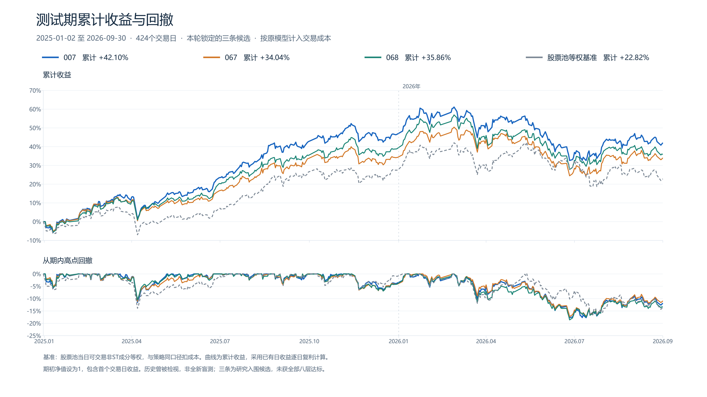

# A股策略研究结果

研究执行于2026年10月17–18日，采用本次复跑及原定邻域任务完成后的最终判定。行情实际截止2026年9月30日。公开材料保留有效数字和研究口径，去除个人目录及工具会话记录；原始行情不随归档分发。

最终交付的[12页PPT与4页签Excel](reports/README.md)一并归档，来源为本轮补检后的最终交付。PPT保留原件，Excel仅脱敏两处个人路径；原文件的展示精度及统计说明问题见随附阅读提示，结果数字以本文及配套CSV/JSON为准。

## 结论

**严格通过八层：0个。** AI三席 `a_r4_007`、`a_r6_067`、`a_r6_068` 最终通过L1–L6，在全局L7相关性去重中淘汰，未进入L8检验。它们按预定的研究入围规则进入三席名单，不能称为“八层达标”或“已证明有效”。

在2025-01-02至2026-09-30共424个交易日的测试集中，三条AI候选均跑赢股票池等权基准；对应60/40组合年化13.48%、绝对最大回撤11.38%。这是值得继续跟踪的历史研究结果，尚不能证明独立于规模、价值和低换手暴露的持久超额。

## 研究定义

| 数据段 | 区间 | 用途 |
|---|---|---|
| 搜索 | 2014–2022 | 假设、配置与迭代 |
| 验证 | 2023–2024 | 筛选及入围评分，参与选择 |
| 测试集 | 2025-01-02至2026-09-30 | 原锁定对象的历史评估，424个交易日 |

历史指数股票池：沪深300、中证500、中证1000的月末历史成分并集；日线信号，T日收盘形成、T+1开盘执行。按历史ST、上市时长、停牌及涨跌停限制可交易性；佣金、印花税与固定滑点见 [rules.md](../research/rules.md)。行业内排名不是组合行业权重严格中性。

A/B分别搜索6轮，共637＋650＝1287个基础配置；主随机种子43生成637个；其余20个种子各637个，共12740个农场基础配置。配置数包含相关参数变体，不等于独立策略族数量。

## 最终漏斗

| 层 | A | B | 主随机seed43 | 20组随机合计 |
|---|---:|---:|---:|---:|
| L1 | 637 | 650 | 486 | 9755 |
| L2 | 460 | 524 | 38 | 911 |
| L3 | 347 | 410 | 2 | 44 |
| L4 | 338 | 410 | 1 | 21 |
| L5 | 333 | 383 | 0 | 17 |
| L6 | 234 | 312 | 0 | 9 |
| L7 | 3 | 14 | 0 | 4 |
| L8 | 0 | 0 | 0 | 0 |

来源：[funnel_counts.csv](funnel_counts.csv)、[逐配置判定](funnel_layers.json)。L7使用全体AI与随机组L6幸存者的共同池，保留21个；不能把各组当成单独去重池来解释计数。L8只评价L7保留对象；被前层剔除的候选，不等于已单独做过DSR且显著失败。

## 三个AI候选是什么

均为周度打分、目标30只等权，使用行业内排名，未启用市值分档排名。

| 配置 | 因子及权重 | 搜索IR | 验证IR | 最终等级 |
|---|---|---:|---:|---|
| 007 | 对数市值−1.25、20日平均换手−0.30、PB−0.50 | 1.3051 | 1.1519 | 入围，L7剔除 |
| 067 | 对数市值−2.00、PB−0.50、120日平均换手−0.75、ROE＋0.25 | 1.3329 | 1.2576 | 入围，L7剔除 |
| 068 | 对数市值−2.00、PB−0.50、250日平均换手−0.75、ROE＋0.25 | 1.3905 | 1.1650 | 入围，L7剔除 |

权重作用于引擎定义的排名因子，不能理解为直接把原始市值、PB、换手率相加。可执行定义见 [strategies/](strategies/) 与引擎。三条同属偏小市值、低换手、价值方向，067/068仅换手窗口不同；搜索＋验证期两两日超额相关性约0.80–0.89，不能视作三条独立收益来源。

## 测试集表现

日收益扣除本模型成本；年化按250个交易日，回撤为策略自身净值的绝对最大回撤。股票池等权基准与组合使用的510300基准不同，不混用超额数值。

| 对象 | 累计收益 | 年化收益 | 绝对最大回撤 | 年化差vs股票池等权 |
|---|---:|---:|---:|---:|
| a_r4_007 | 42.10% | 23.02% | −17.72% | ＋10.14个百分点 |
| a_r6_067 | 34.04% | 18.85% | −17.27% | ＋5.97个百分点 |
| a_r6_068 | 35.86% | 19.81% | −18.60% | ＋6.92个百分点 |
| m43_042 | 19.70% | 11.18% | −22.36% | −1.70个百分点 |
| m43_092 | 19.06% | 10.83% | −25.37% | −2.05个百分点 |
| m43_172 | 31.49% | 17.52% | −16.07% | ＋4.63个百分点 |
| 股票池等权 | 22.82% | 12.88% | −16.58% | — |

主随机三席也是研究入围对象：042未过L4、未执行L5；092未过L5且验证期为负，属于补位；172未过L3/L4、未执行L5且验证期为负，属于补位。详见 [shortlist_monkey_43.json](shortlist_monkey_43.json)。随机三席中仅172跑赢基准。

| 年度 | 007 | 067 | 068 | 股票池等权 |
|---|---:|---:|---:|---:|
| 2025 | 46.82% | 34.29% | 39.19% | 27.51% |
| 2026至9月30日 | −3.22% | −0.19% | −2.39% | −3.68% |

三条2026年至截止日的绝对收益均为负；相对跑赢不能表述为每年都赚钱。完整六条日收益在 [test_returns/](test_returns/)，复算值在 [test_metrics.json](test_metrics.json)。

## 组合与随机分布

组合是底仓60%＋三席等权卫星40%。底仓按事先定义的510300/黄金ETF趋势规则切换，不等于三策略满仓平均。

| 组合 | 测试集年化 | 绝对最大回撤 | 年化差vs510300买入持有 |
|---|---:|---:|---:|
| AI | 13.48% | −11.38% | ＋4.55个百分点 |
| 主随机 | 10.72% | −13.10% | ＋1.80个百分点 |

搜索期2014–2015缺ETF复权因子，完整搜索期组合指标不可用；JSON中的null表示缺失，不能当成0。验证期与测试集组合指标见 [portfolio_AI.json](portfolio_AI.json)、[portfolio_monkey_43.json](portfolio_monkey_43.json)。

搜索期基础配置年化超额中位数：A约9.46%，B约9.20%。20组随机的12620个成功收益样本合并中位数约−10.13%；先取每组中位数、再对20个中位数取中位数，约−10.07%。两者是不同统计对象。有效样本12620小于生成配置12740，失败记录仍在台账中，不把缺失当作零收益。可由 [search_base_metrics.csv](search_base_metrics.csv) 复核。

AI与随机组在生成方式、迭代预算、配置族构成上存在差异；这组对照说明本搜索空间里的分布差异，不能单独证明某工具或模型带来因果优势。

## 口径与研究限制

- **历史可见性**：设计者曾在早期探索中查看过相关历史区间的大致表现。此轮新配置未把测试集收益用于搜索，但结果应称为历史保留期评估，不称为从未触碰的盲测。验证期本身也参与筛选。
- **任务完成顺序**：746个原定邻域任务因内存错误恢复成功，沿用原参数和区间，恢复在测试集评估后完成；六席成员与顺序未更换。最终漏斗是任务完成后的判定，不能倒称为开封前已具备的筛选结论。
- **组合边界修正**：组合评估曾包含行情截止日之后的空白日历，修正后只统计424个实际交易日。本归档组合数字使用修正版，不将技术错误修复描述为收益优化。
- **试验总数**：台账23904行保留了技术校验、失败、重试、探针与补算。规则下AI的N为4637、主随机N为649；这不是独立经济假设数，DSR仍受相关试验和试验数口径限制。
- **邻域检验范围**：007、067、068分别只有2、2、1个可移动窗口邻居。它们通过本次定义的L5，不代表已检验全部因子组合、权重与结构变化。
- **时点与数据覆盖**：月末历史指数成分是近似股票池；北向披露时点及覆盖变化尚未全部核清。三条最终AI候选未用北向因子，不代表所有资金面策略都已得到完整时点审核。
- **风格与容量**：尚缺相同规模、价值、低换手暴露的强风格基准。容量仅采用单日买入不超过成交额1%的粗估，不包含完整冲击模型、真实开盘成交深度和实际资金可承载性保证。

公开结果的目标是可核对研究过程与结论，不保证原数据重新下载逐字节一致，也不保证AI重新搜索产生相同名单。继续研究应补充风格基准、成本/容量敏感性及之后未用于设计的新数据。
