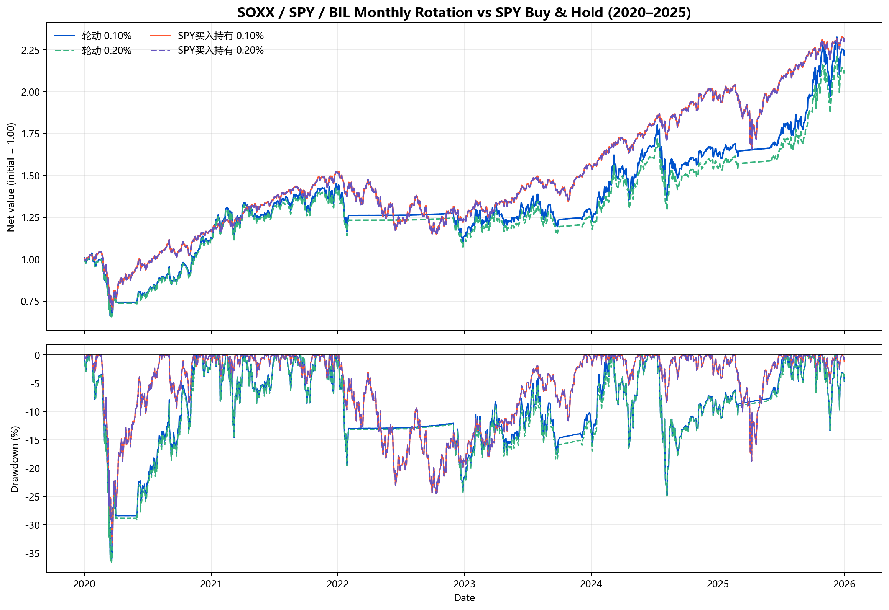

# SOXX、SPY、BIL 月度轮动策略回测报告

## 一、结论摘要

回测区间为 **2020-01-02 开盘至 2025-12-31 收盘**，初始资金 **$100,000**，允许碎股，不做参数优化。基础单边费率为 **0.10%**，压力情形为 **0.20%**；买入持有基准也在同一日起始开盘买入 SPY，并支付相同费率。

- 基础费率下，轮动策略期末资产 **$221,684.42**，累计收益 **121.68%**，年化收益 **14.20%**，最大回撤 **-36.40%**。
- 同费率 SPY 买入持有期末资产 **$229,908.51**，累计收益 **129.91%**，年化收益 **14.89%**，最大回撤 **-33.70%**。
- 费率从 0.10% 提至 0.20% 后，轮动策略期末资产减少 **$11,022.15**，SPY 基准减少 **$229.45**。差额包含费用本身及复利机会成本，不等于费用总额的简单差额。
- 期末均按 2025-12-31 收盘价估值，未强制清仓，也未计任何假想平仓费。

| 组合 | 期末资产 | 累计收益 | 年化收益 | 最大回撤 | 年化波动 | 总费用 | 买/卖笔数 |
|---|---|---|---|---|---|---|---|
| 轮动 0.10% | $221,684.42 | 121.68% | 14.20% | -36.40% | 26.97% | $6,568.37 | 26 / 25 |
| 轮动 0.20% | $210,662.27 | 110.66% | 13.23% | -36.66% | 26.97% | $12,776.46 | 26 / 25 |
| SPY买入持有 0.10% | $229,908.51 | 129.91% | 14.89% | -33.70% | 20.74% | $99.90 | 1 / 0 |
| SPY买入持有 0.20% | $229,679.06 | 129.68% | 14.88% | -33.70% | 20.74% | $199.60 | 1 / 0 |

## 二、策略与成交口径

1. **信号**：每个自然月最后一个交易日收盘后，以现金分红和拆股复权收盘价计算 `当日复权收盘 / 60 个交易日前复权收盘 - 1`。该定义有 60 个日收益区间、使用 61 个收盘观察值。
2. **选择规则**：SOXX 与 SPY 中过去 60 日总回报较高且为正者入选；相等且为正时选 SPY；两者都不满足正回报条件时持有 BIL。
3. **执行**：信号次一交易日按 Yahoo 未做现金分红复权的开盘价全仓成交。持仓不变不交易，因此不产生费用。
4. **初始持仓**：2019-12-31 信号的 SOXX 60 日回报为 **18.03%**、SPY 为 **9.88%**，选择 **SOXX**，于 **2020-01-02 开盘**建仓。
5. **最后一次已执行信号**：2025-11-28 选择 **SOXX**，于 2025-12-01 开盘执行。2025-12-31 信号需在 2026 年执行，不纳入本回测。
6. **费用**：买入满足 `股数 = 可用现金 / [开盘价 × (1 + 费率)]`，费用为买入成交额乘费率；卖出费用同样为卖出成交额乘费率。换仓卖出与买入分别收费。

## 三、分红、拆股与估值

- **分红**：Yahoo 公司行动中的每股现金分红按除息日归属。若当日开盘换仓，先按新持仓成交，再在当日收盘将新持仓应得现金分红按当日收盘价再投资；不再另收再投资费用。持仓随分红增加，因而不需要把分红留作闲置现金。BIL 的收益也通过这一机制计入。
- **拆股**：Yahoo 历史 OHLC 与分红金额均已按后续拆股调整，回测股数也是拆股调整后的可比股数。SOXX 在 **2024-03-07** 的 **3:1** 拆股已计入数据，不被当作投资损失或收益。SPY、BIL 在回测期无拆股。
- **信号价格**：使用 `adj_close`，即拆股和现金分红复权收盘价。**成交与期末估值**：使用未做现金分红复权的 `open` / `close`，并单独用分红账本增加股数，避免重复计息。
- **对账**：用 `(当日收盘 + 当日每股分红) / 前收盘` 自建总回报指数，与 Yahoo `adj_close` 比较；三只 ETF 全样本最大相对误差为 **0.069624%**，差异主要来自供应商精度与舍入。SOXX 另与腾讯前复权日收益交叉检查，见 `data_validation.json`。
- **其他假设**：无滑点、买卖价差、税费和分红预扣税；开盘价可足额成交；分红再投资允许碎股。现金只在同一换仓流程中瞬时存在，不另计利息。

## 四、分年度收益

| 年份 | 轮动 0.10% | 轮动 0.20% | SPY买入持有 0.10% | SPY买入持有 0.20% |
|---|---|---|---|---|
| 2020 | 12.87% | 11.86% | 17.64% | 17.52% |
| 2021 | 25.35% | 23.86% | 28.74% | 28.74% |
| 2022 | -19.88% | -20.20% | -18.17% | -18.17% |
| 2023 | 14.52% | 13.15% | 26.19% | 26.19% |
| 2024 | 24.50% | 23.51% | 24.89% | 24.89% |
| 2025 | 37.16% | 36.34% | 17.72% | 17.72% |

## 五、回撤、交易与持仓

- **轮动 0.10%**：最大回撤 -36.40%，峰值日 2020-01-23，谷底日 2020-03-20，修复日 2020-11-16；分红再投资 35 次，期末持有 SOXX。
- **轮动 0.20%**：最大回撤 -36.66%，峰值日 2020-01-23，谷底日 2020-03-20，修复日 2020-11-23；分红再投资 35 次，期末持有 SOXX。
- **SPY买入持有 0.10%**：最大回撤 -33.70%，峰值日 2020-02-19，谷底日 2020-03-23，修复日 2020-08-10；分红再投资 24 次，期末持有 SPY。
- **SPY买入持有 0.20%**：最大回撤 -33.70%，峰值日 2020-02-19，谷底日 2020-03-23，修复日 2020-08-10；分红再投资 24 次，期末持有 SPY。

轮动持仓日期分布（两档费率信号相同）：BIL 357 日（23.7%）、SOXX 846 日（56.1%）、SPY 305 日（20.2%）。逐次买卖、信号、成交价、股数和费用见 `trades.csv`；持仓不变但无成交的月份见 `signals.csv`。

## 六、全部月度信号

| 信号日 | 执行日 | SOXX 60日总回报 | SPY 60日总回报 | 目标 |
|---|---|---|---|---|
| 2019-12-31 | 2020-01-02 | 18.03% | 9.88% | SOXX |
| 2020-01-31 | 2020-02-03 | 3.97% | 5.19% | SPY |
| 2020-02-28 | 2020-03-02 | 1.19% | -4.47% | SOXX |
| 2020-03-31 | 2020-04-01 | -18.13% | -19.59% | BIL |
| 2020-04-30 | 2020-05-01 | -6.95% | -11.21% | BIL |
| 2020-05-29 | 2020-06-01 | 3.84% | -2.16% | SOXX |
| 2020-06-30 | 2020-07-01 | 38.51% | 24.79% | SOXX |
| 2020-07-31 | 2020-08-03 | 25.42% | 15.38% | SOXX |
| 2020-08-31 | 2020-09-01 | 13.11% | 9.87% | SOXX |
| 2020-09-30 | 2020-10-01 | 11.35% | 7.15% | SOXX |
| 2020-10-30 | 2020-11-02 | 2.36% | -1.94% | SOXX |
| 2020-11-30 | 2020-12-01 | 19.28% | 5.25% | SOXX |
| 2020-12-31 | 2021-01-04 | 22.66% | 12.11% | SOXX |
| 2021-01-29 | 2021-02-01 | 27.94% | 12.55% | SOXX |
| 2021-02-26 | 2021-03-01 | 15.46% | 5.50% | SOXX |
| 2021-03-31 | 2021-04-01 | 12.50% | 7.82% | SOXX |
| 2021-04-30 | 2021-05-03 | 4.38% | 9.64% | SPY |
| 2021-05-28 | 2021-06-01 | 12.58% | 11.87% | SOXX |
| 2021-06-30 | 2021-07-01 | 2.55% | 5.75% | SPY |
| 2021-07-30 | 2021-08-02 | 10.72% | 5.82% | SOXX |
| 2021-08-31 | 2021-09-01 | 8.11% | 7.31% | SOXX |
| 2021-09-30 | 2021-10-01 | 0.93% | -0.91% | SOXX |
| 2021-10-29 | 2021-11-01 | 1.64% | 4.29% | SPY |
| 2021-11-30 | 2021-12-01 | 12.67% | 0.87% | SOXX |
| 2021-12-31 | 2022-01-03 | 22.66% | 9.59% | SOXX |
| 2022-01-31 | 2022-02-01 | -2.76% | -2.85% | BIL |
| 2022-02-28 | 2022-03-01 | -9.51% | -2.74% | BIL |
| 2022-03-31 | 2022-04-01 | -14.01% | -5.13% | BIL |
| 2022-04-29 | 2022-05-02 | -18.99% | -9.64% | BIL |
| 2022-05-31 | 2022-06-01 | -4.99% | -4.16% | BIL |
| 2022-06-30 | 2022-07-01 | -25.76% | -17.06% | BIL |
| 2022-07-29 | 2022-08-01 | -2.31% | -0.63% | BIL |
| 2022-08-31 | 2022-09-01 | -12.21% | -3.62% | BIL |
| 2022-09-30 | 2022-10-03 | -10.20% | -7.80% | BIL |
| 2022-10-31 | 2022-11-01 | -21.70% | -6.21% | BIL |
| 2022-11-30 | 2022-12-01 | 9.99% | 4.76% | SOXX |
| 2022-12-30 | 2023-01-03 | 0.26% | 1.88% | SPY |
| 2023-01-31 | 2023-02-01 | 27.01% | 8.93% | SOXX |
| 2023-02-28 | 2023-03-01 | 5.91% | -2.35% | SOXX |
| 2023-03-31 | 2023-04-03 | 26.12% | 7.09% | SOXX |
| 2023-04-28 | 2023-05-01 | -2.72% | 1.64% | SPY |
| 2023-05-31 | 2023-06-01 | 15.24% | 3.70% | SOXX |
| 2023-06-30 | 2023-07-03 | 17.41% | 8.87% | SOXX |
| 2023-07-31 | 2023-08-01 | 31.33% | 12.61% | SOXX |
| 2023-08-31 | 2023-09-01 | 6.09% | 5.61% | SOXX |
| 2023-09-29 | 2023-10-02 | -3.81% | -2.43% | BIL |
| 2023-10-31 | 2023-11-01 | -14.36% | -6.89% | BIL |
| 2023-11-30 | 2023-12-01 | 1.45% | 2.64% | SPY |
| 2023-12-29 | 2024-01-02 | 22.20% | 12.38% | SOXX |
| 2024-01-31 | 2024-02-01 | 26.80% | 12.55% | SOXX |
| 2024-02-29 | 2024-03-01 | 26.61% | 11.12% | SOXX |
| 2024-03-28 | 2024-04-01 | 22.17% | 11.01% | SOXX |
| 2024-04-30 | 2024-05-01 | 7.74% | 1.86% | SOXX |
| 2024-05-31 | 2024-06-03 | 1.91% | 3.78% | SPY |
| 2024-06-28 | 2024-07-01 | 9.55% | 5.11% | SOXX |
| 2024-07-31 | 2024-08-01 | 9.03% | 8.08% | SOXX |
| 2024-08-30 | 2024-09-03 | -4.65% | 5.77% | SPY |
| 2024-09-30 | 2024-10-01 | -9.27% | 3.76% | SPY |
| 2024-10-31 | 2024-11-01 | 9.79% | 9.97% | SPY |
| 2024-11-29 | 2024-12-02 | 1.35% | 9.97% | SPY |
| 2024-12-31 | 2025-01-02 | -6.60% | 2.63% | SPY |
| 2025-01-31 | 2025-02-03 | -0.95% | 5.74% | SPY |
| 2025-02-28 | 2025-03-03 | -3.04% | -1.06% | BIL |
| 2025-03-31 | 2025-04-01 | -12.57% | -4.27% | BIL |
| 2025-04-30 | 2025-05-01 | -14.06% | -6.95% | BIL |
| 2025-05-30 | 2025-06-02 | -0.69% | 1.39% | SPY |
| 2025-06-30 | 2025-07-01 | 26.25% | 9.77% | SOXX |
| 2025-07-31 | 2025-08-01 | 27.57% | 12.50% | SOXX |
| 2025-08-29 | 2025-09-02 | 13.40% | 8.56% | SOXX |
| 2025-09-30 | 2025-10-01 | 13.78% | 7.63% | SOXX |
| 2025-10-31 | 2025-11-03 | 27.55% | 8.18% | SOXX |
| 2025-11-28 | 2025-12-01 | 21.79% | 5.57% | SOXX |

## 七、数据来源与复现

- 主数据：**Yahoo Finance v8 chart**，日线 OHLC、`adjclose`、`events=div,splits`。本次下载为 2018-01-02 至 2025-12-31，每只 2,011 根共同交易日日线。原始 JSON、精确请求 URL、抓取时间与 CSV 均在 `data/`。
- 独立复权核验：SOXX 腾讯 `gtimg-fqkline` 前复权日线，通过 institutional-finance-kit 的 finance-data 场景取得；原始文件位于 `data/raw/SOXX_gtimg_qfq_kline.json`。
- 运行：在本目录执行 `python backtest.py` 即可离线复算；执行 `python fetch_data.py && python backtest.py` 会重新下载后再回测。依赖见 `requirements.txt`。
- 数据快照抓取于 2026-10-27；供应商后续修订历史数据可能使重新下载的结果略有变化。随附数据快照是本次报告数字的复现依据。

> 本报告是历史规则回测，不构成收益承诺或投资建议。
